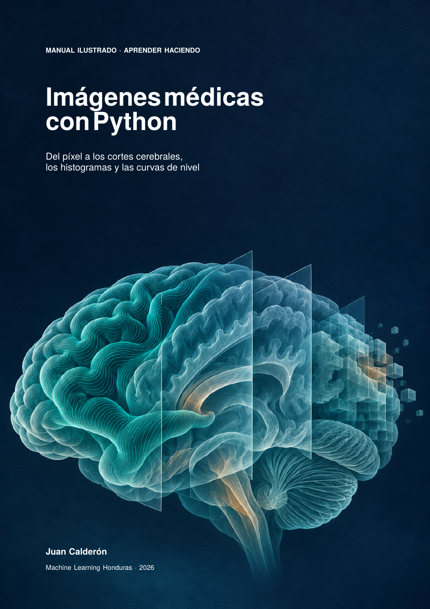

# Análisis de datos médicos · ML Honduras 2026

## Imágenes médicas con Python

**Juan Calderón · UNAH**  
**Viernes 27 de noviembre de 2026 · 13:30–14:30 · Honduras (UTC−6)**

Taller introductorio de la [Escuela de Machine Learning y Data Science en Honduras](https://machine-learning-honduras.org/). Fecha y título según el [programa público](https://machine-learning-honduras.org/programa/), consultado el 23 de noviembre de 2026. Revisa esa página por si la organización comunica cambios.

**[Página del taller: todos los accesos](https://FisikMedik.github.io/taller-imagenes-medicas-python/)**

[](https://colab.research.google.com/github/FisikMedik/taller-imagenes-medicas-python/blob/main/Taller_en_vivo_60min.ipynb)

[Diapositivas web](https://FisikMedik.github.io/taller-imagenes-medicas-python/presentacion.html) · [Presentación PDF](Presentacion_taller.pdf) · [PowerPoint editable](Presentacion_taller.pptx) · [Explorador visual](https://FisikMedik.github.io/taller-imagenes-medicas-python/explorador.html)


*Una plantilla cerebral, tres planos. Las imágenes proceden de una referencia pública MNI152; no son estudios privados de pacientes.*

## Empieza aquí

1. Abre el **[cuaderno en vivo de 60 minutos](https://colab.research.google.com/github/FisikMedik/taller-imagenes-medicas-python/blob/main/Taller_en_vivo_60min.ipynb)**. Inicia sesión en Google y guarda una copia si deseas conservar tus cambios.
2. Ejecuta la primera celda pulsando su triángulo o **Mayús + Enter**. Espera a ver tres cortes del cerebro. Usa CPU; no necesitas GPU ni conectar tus archivos de Drive al cuaderno.
3. Sigue las celdas en orden. Predice qué cambiará, modifica un parámetro y compara. Cada ejercicio ofrece una pista y una solución explicada.

El **[explorador visual](https://FisikMedik.github.io/taller-imagenes-medicas-python/explorador.html)** permite empezar sin programar y sirve de alternativa si Colab no está disponible. Descarga `explorador.html` para abrirlo sin internet: sus datos están incluidos en el propio archivo.

No necesitas leer todo el libro antes de asistir. Como lectura previa opcional, observa las figuras y la introducción a MNI152 y Nilearn del **[manual ilustrado en PDF](Guia_visual_imagenes_medicas.pdf)**. Si nunca has usado GitHub o Colab, consulta la **[guía de acceso](Guia_GitHub_paso_a_paso.pdf)**.

## Dos ritmos de aprendizaje

| Recurso | Cuándo usarlo | Qué incluye |
|---|---|---|
| [Cuaderno en vivo](Taller_en_vivo_60min.ipynb) | Durante la hora del taller | 8 celdas de código, imágenes desde la primera salida, explicación, variaciones y ejercicios resueltos. |
| [Presentación](https://FisikMedik.github.io/taller-imagenes-medicas-python/presentacion.html) | Para seguir la explicación o facilitarla | Diapositivas visuales con tiempos, preguntas y notas para el instructor; PDF y PowerPoint disponibles. |
| [Explorador](https://FisikMedik.github.io/taller-imagenes-medicas-python/explorador.html) | Antes, durante o sin Python | Tres cortes, ventana de contraste, histograma y máscara por percentil; sin dependencias web. |
| [Cuaderno completo](https://colab.research.google.com/github/FisikMedik/taller-imagenes-medicas-python/blob/main/Taller_imagenes_medicas.ipynb) | Estudio posterior, en varias sesiones | 24 lecciones detalladas, salidas guardadas, matrices, filtros y ampliaciones. |
| [Manual ilustrado](Guia_visual_imagenes_medicas.pdf) | Consulta y lectura autónoma | 95 páginas, 8 capítulos, 3 anexos, 15 tutoriales y 31 figuras diferentes. |

El manual explica qué es un píxel, cómo leer una matriz, de dónde procede ICBM152 y qué hace Nilearn. Distingue imagen individual, plantilla, atlas y espacio de referencia. Sus tutoriales combinan código, salida e interpretación. El **[proyecto LaTeX completo](Fuente_LaTeX_manual.zip)** contiene los recursos necesarios para editarlo y recompilarlo; también puedes leer la [fuente principal](Guia_visual_imagenes_medicas.tex).

<a href="Guia_visual_imagenes_medicas.pdf"></a>

Las figuras científicas se obtienen de datos y cálculos documentados. La portada del libro es una ilustración conceptual generada con IA.

## Qué aprenderás

- Comprender de dónde procede la plantilla MNI152 y distinguir datos, bibliotecas, atlas y espacio de referencia.
- Relacionar una matriz de números con píxeles, vóxeles y tonos de gris.
- Explorar cortes axial, coronal y sagital y distinguir índices de milímetros.
- Cambiar el contraste y explicar qué cambia en la presentación y qué permanece en los datos.
- Construir un histograma contando valores, elegir intervalos y reconocer el efecto del fondo.
- Distinguir percentiles, umbrales, máscaras y curvas de nivel.
- Comparar media, filtro gaussiano y mediana con la misma entrada.
- Observar perfiles de intensidad y medir cambios con Sobel.
- Documentar una secuencia de procesamiento y comprender por qué una evaluación de ML debe separar pacientes.

El taller introduce la **visualización y el procesamiento previo al aprendizaje automático**. No entrena un modelo ni presenta una evaluación diagnóstica.

## Abrir el cuaderno en Google Colab

Necesitas una computadora con navegador e internet. No necesitas instalar Python, disponer de GPU ni conectar tu Google Drive al cuaderno.

1. Pulsa **Abrir en Google Colab** en la parte superior de esta página.
2. Inicia sesión en Google si Colab lo solicita. Para conservar tus cambios, elige **Archivo → Guardar una copia en Drive**. Esto guarda tu cuaderno; no monta tus archivos de Drive en la sesión.
3. Pulsa el botón triangular de la primera celda o usa **Mayús + Enter**. Una celda es un bloque de código; su resultado aparece debajo. Espera a que termine antes de continuar.
4. Ejecuta las siguientes celdas en orden. La primera prepara las bibliotecas y carga la plantilla; las demás utilizan los datos creados antes.
5. Cuando llegues a una indicación **Cambia**, modifica sólo el parámetro propuesto, ejecuta de nuevo y compara la imagen. Luego consulta la respuesta explicada.

La primera ejecución puede tardar mientras se instalan las bibliotecas que falten. Usa el entorno normal de **CPU**. La plantilla se carga desde `datos/mni152_2mm.nii.gz` si ese archivo está disponible; al abrir sólo el cuaderno en Colab, se obtiene mediante Nilearn.

Si aparece un mensaje como `NameError`, probablemente falta ejecutar una celda anterior. Vuelve a la primera y continúa en orden. Si reinicias la sesión, también debes volver a crear sus variables. Para una explicación ilustrada de archivos, enlaces y botones, consulta la [guía de GitHub y Colab](Guia_GitHub_paso_a_paso.pdf).

## Ruta preparada para una sesión de una hora

Utiliza **Taller_en_vivo_60min.ipynb** en la sesión. Prepara su primera celda antes de comenzar; las salidas guardadas también permiten seguir el razonamiento si la conexión tarda. La presentación incluye notas para explicar cada imagen y repartir el tiempo.

| Minutos | Actividad | Qué debe poder explicar el participante |
|---|---|---|
| 0–10 | Primera imagen y tres planos | Una imagen contiene valores en una rejilla; la plantilla no es un paciente nuevo. |
| 10–20 | Geometría y contraste | Un índice no es una distancia; cambiar la ventana no cambia la matriz. |
| 20–35 | Histograma, percentil y máscara | Qué cuenta cada barra, por qué se excluye el fondo y qué selecciona el umbral. |
| 35–43 | Curvas de nivel sobre el cerebro | Una curva une posiciones de igual intensidad; una máscara selecciona una región. |
| 43–55 | Filtros y Sobel | Suavizar reduce variaciones y también puede borrar detalles; Sobel mide cambios. |
| 55–60 | Tres preguntas resueltas | Explicar visualización, empates en percentiles y el compromiso del suavizado. |

El cuaderno completo de 24 lecciones es material de profundización. No se pretende ejecutar y explicar todo ese recorrido durante la hora asignada.

## Para quien facilita el taller

1. Abre la [presentación web](https://FisikMedik.github.io/taller-imagenes-medicas-python/presentacion.html), su sección de notas y el cuaderno en vivo en dos pestañas. Descarga también el PDF y `explorador.html` como respaldo.
2. Ejecuta el cuaderno en orden antes de la sesión. Comprueba la imagen inicial, el histograma, las curvas del cerebro y la comparación de bordes.
3. Pide una predicción antes de cada variación. Mantén una sola modificación por vez y utiliza las pistas antes de mostrar la solución.
4. Si la instalación se retrasa, continúa con las salidas guardadas y el explorador. Reserva los últimos cinco minutos para las tres preguntas, aunque debas dejar una variación como tarea.
5. Al cerrar, enlaza con ML: los filtros de este taller se especifican manualmente; una red convolucional aprende filtros a partir de datos y un objetivo. Entrenar y evaluar exige datos independientes, etiquetas pertinentes y separación adecuada por pacientes. Esta plantilla no constituye un conjunto de entrenamiento clínico.

## Trabajar en tu computadora con Windows

Esta opción utiliza JupyterLab, una aplicación que abre el cuaderno en el navegador y ejecuta Python en tu computadora. La instalación inicial necesita internet. Después podrás utilizar la plantilla incluida sin descargarla de nuevo.

1. Instala **Python 3.12** desde [python.org](https://www.python.org/downloads/windows/), incluido el lanzador de Python para Windows.
2. En este repositorio, pulsa **Code → Download ZIP** y extrae el archivo. Conserva juntas la carpeta `datos`, el cuaderno y los demás archivos.
3. Abre la carpeta extraída en el Explorador de archivos. Escribe `powershell` en su barra de dirección y pulsa Enter. La terminal se abrirá en esa carpeta.
4. Ejecuta las siguientes líneas, una por una:

```powershell
py -3.12 -m venv .venv
.\.venv\Scripts\python.exe -m pip install -r requirements.txt
.\.venv\Scripts\python.exe -m jupyterlab
```

La primera línea crea un entorno separado para las bibliotecas del taller; la segunda las instala; la tercera abre JupyterLab. No hace falta activar el entorno ni cambiar la política de ejecución de PowerShell.

En JupyterLab, abre `Taller_en_vivo_60min.ipynb` para la ruta breve o `Taller_imagenes_medicas.ipynb` para el recorrido completo y ejecuta las celdas en orden. Mantén abierta la terminal mientras trabajas. Para volver otro día, abre una terminal en la misma carpeta y ejecuta sólo la última línea. Si usas otra instalación compatible de Python, adapta la primera línea a su versión.

### Comprobación de esta edición

La revisión del 23 de noviembre de 2026 incorpora una ruta breve, una presentación y una página pública de acceso. El manual y el cuaderno completo conservan la validación de la edición anterior descrita a continuación.

Las 24 celdas se ejecutaron localmente utilizando la plantilla incluida. El entorno de comprobación utilizó Python 3.12.14, Nilearn 0.12.1, NumPy 2.5.4, Matplotlib 3.11.2, NiBabel 5.4.2 y SciPy 1.18.1. El cuaderno conserva las salidas de esa ejecución. También se ejecutaron las 24 celdas desde el enlace público en Google Colab el 16 de noviembre de 2026, con un entorno de CPU y la carga alternativa de la plantilla mediante Nilearn. Se comprobó que la última celda terminó y mostró 232 posiciones sustituidas de un corte de 11 583 píxeles.

`requirements.txt` mantiene intervalos de versiones compatibles; no es una copia congelada de todas las dependencias del entorno de comprobación.

El manual se compiló con XeLaTeX y se revisaron visualmente sus 95 páginas. También se extrajo el ZIP de la fuente en una carpeta independiente y se recompiló: conserva las 95 páginas y el mismo contenido textual. El generador portátil reprodujo las 20 figuras nuevas con huellas SHA-256 idénticas. El paquete incluye las imágenes ya preparadas, los datos públicos, las fuentes de código con su licencia y las instrucciones de compilación; Python solo se necesita si deseas regenerar las figuras.

## Archivos del repositorio

- [`index.html`](index.html) y [`estilo_web.css`](estilo_web.css): página pública del taller, publicada mediante GitHub Pages.
- [`Taller_en_vivo_60min.ipynb`](Taller_en_vivo_60min.ipynb): ruta breve de la sesión, con salidas guardadas.
- [`presentacion.html`](presentacion.html), [`Presentacion_taller.pdf`](Presentacion_taller.pdf) y [`Presentacion_taller.pptx`](Presentacion_taller.pptx): diapositivas web, copia para lectura y versión editable.
- [`explorador.html`](explorador.html): herramienta autónoma con datos incorporados; puede abrirse sin conexión.

- [`Guia_visual_imagenes_medicas.pdf`](Guia_visual_imagenes_medicas.pdf): manual ilustrado por capítulos, con explicaciones, ejemplos, código, salidas interpretadas y ejercicios resueltos.
- [`Guia_visual_imagenes_medicas.tex`](Guia_visual_imagenes_medicas.tex): fuente principal del manual en LaTeX; para recompilarla se necesitan los recursos del paquete completo.
- [`Fuente_LaTeX_manual.zip`](Fuente_LaTeX_manual.zip): proyecto completo con fuente, figuras, portada, estilo e instrucciones para XeLaTeX y Overleaf.
- [`Guia_GitHub_paso_a_paso.pdf`](Guia_GitHub_paso_a_paso.pdf): instrucciones para acceder al material y utilizar el cuaderno.
- [`Taller_imagenes_medicas.ipynb`](Taller_imagenes_medicas.ipynb): las 24 lecciones de Python.
- [`datos/mni152_2mm.nii.gz`](datos/mni152_2mm.nii.gz): plantilla cerebral utilizada en los ejemplos locales.
- [`imagenes/`](imagenes/): figuras de apoyo.
- [`requirements.txt`](requirements.txt): bibliotecas para ejecutar el cuaderno localmente.
- [`FUENTES_Y_LICENCIAS.txt`](FUENTES_Y_LICENCIAS.txt): procedencia de datos, aviso íntegro del atlas y referencias.

## Editar y compilar el manual

Para modificar el libro, descarga [el proyecto LaTeX completo](Fuente_LaTeX_manual.zip). El archivo `.tex` por separado sirve para leer el texto fuente; el ZIP reúne también las imágenes y los demás recursos necesarios para producir el PDF. Consulta primero el **README incluido dentro del ZIP**, que indica la organización del proyecto y los pasos de compilación.

En [Overleaf](https://www.overleaf.com/), crea un proyecto mediante **New Project → Upload Project** y sube el ZIP. Conserva su estructura de carpetas, selecciona el documento principal indicado en su README y elige **XeLaTeX** como compilador antes de recompilar. Las instrucciones oficiales explican cómo [subir un proyecto completo](https://www.overleaf.com/learn/Uploading_a_project) y [seleccionar el compilador](https://docs.overleaf.com/getting-started/recompiling-your-project/selecting-a-tex-live-version-and-latex-compiler).

También puedes compilar localmente con XeLaTeX siguiendo las instrucciones del paquete. Editar el manual y ejecutar el cuaderno son tareas independientes: no necesitas LaTeX ni Overleaf para leer el PDF o practicar con Python.

## Datos fuentes y licencias

Utilizamos la **plantilla T1 MNI152 distribuida con Nilearn 0.12.1**, remuestreada a 2 mm para esta práctica. Es una referencia anatómica agregada, no una colección de pacientes independientes. La matriz pequeña, las superficies matemáticas y el ruido se generan con código. El repositorio no incorpora archivos clínicos privados del facilitador.

**Nota de procedencia:** la documentación de `load_mni152_template` en Nilearn 0.12.1 describe la plantilla como ICBM152 2009a asimétrica, mientras que el código de esa versión carga el archivo interno `mni_icbm152_t1_tal_nlin_sym_09a_converted.nii.gz`. Conservamos ambas evidencias sin resolver la discrepancia por el nombre del archivo ni afirmar una variante de simetría no confirmada. La fuente, la versión, la derivación y la huella SHA-256 de la copia utilizada están documentadas en [FUENTES_Y_LICENCIAS.txt](FUENTES_Y_LICENCIAS.txt).

El atlas conserva el permiso de uso y distribución de McGill, reproducido íntegramente en [FUENTES_Y_LICENCIAS.txt](FUENTES_Y_LICENCIAS.txt), junto con las referencias solicitadas por su proveedor. Las bibliotecas conservan sus propias licencias. Esas condiciones deben distinguirse de la autoría del texto y del código docente.

Para datos clínicos reales, la guía explica qué debe revisarse antes de compartir: autorización de uso, metadatos, identificadores impresos en píxeles, rasgos faciales y archivos acompañantes. Cambiar un nombre de archivo o convertir DICOM a NIfTI no constituye por sí solo una anonimización.

Referencias principales:

- [MNI152 lineal](https://www.bic.mni.mcgill.ca/ServicesAtlases/ICBM152Lin), [ICBM152 no lineal de 2009](https://www.bic.mni.mcgill.ca/ServicesAtlases/ICBM152NLin2009) y [métodos y cohorte descritos por Fonov y colaboradores](https://pmc.ncbi.nlm.nih.gov/articles/PMC2962759/).
- [Introducción a Nilearn](https://nilearn.github.io/0.12.1/introduction.html), [función de carga MNI152](https://nilearn.github.io/0.12.1/modules/generated/nilearn.datasets.load_mni152_template.html) y [código fuente de Nilearn 0.12.1](https://github.com/nilearn/nilearn/blob/0.12.1/nilearn/datasets/struct.py).
- [Formato NIfTI](https://nifti.nimh.nih.gov/nifti-1/documentation/faq/), [objetos de imagen en NiBabel](https://nipy.org/nibabel/nibabel_images.html), [coordenadas](https://nipy.org/nibabel/coordinate_systems.html) y [orientación de los vóxeles](https://nipy.org/nibabel/image_orientation.html).
- [Python](https://docs.python.org/3/tutorial/) y [NumPy para principiantes](https://numpy.org/doc/stable/user/absolute_beginners.html).
- [Visualización con Matplotlib](https://matplotlib.org/stable/api/_as_gen/matplotlib.pyplot.imshow.html) y [procesamiento de imágenes con SciPy](https://docs.scipy.org/doc/scipy/reference/ndimage.html).
- [Ejemplo de atlas de etiquetas y probabilístico](https://nilearn.github.io/stable/modules/generated/nilearn.datasets.fetch_atlas_harvard_oxford.html) e [identificadores y metadatos de plantillas en TemplateFlow](https://www.templateflow.org/python-client/master/notebooks/01_quickstart.html).
- [Perfiles de confidencialidad DICOM](https://dicom.nema.org/medical/dicom/current/output/chtml/part15/chapter_E.html).
- [Prevención de fuga de información en aprendizaje automático](https://scikit-learn.org/stable/common_pitfalls.html#data-leakage).

## Relación con los materiales de la escuela

La organización de esta edición —acceso web, diapositivas, Colab, ejercicios con pistas y soluciones, repositorio y fuentes— toma como referencia los [materiales publicados por la escuela](https://machine-learning-honduras.org/materiales/), los de [Edith Natalia Villegas](https://edithvillegas.github.io/introduccion-ml-redes-neuronales/) y los de [Daniela Pérez](https://dapivei.github.io/escuela-machine-learning-honduras-2026/). Son prácticas docentes observadas, no una rúbrica oficial ni una aprobación formal de este material por la organización.

El sitio es el recurso del expositor y se mantiene en su repositorio personal. La información institucional y posibles cambios de horario corresponden a la [web oficial](https://machine-learning-honduras.org/).

**Autor del material docente:** Juan Calderón · **Revisión de acceso y sesión:** 23 de noviembre de 2026 · **Edición del manual:** 16 de noviembre de 2026.
