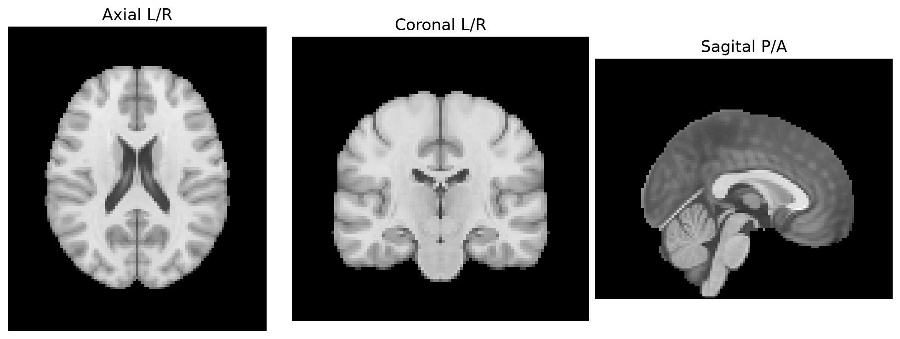

# Imágenes médicas con Python

**Juan Calderón · UNAH · Escuela de Machine Learning y Data Science en Honduras 2026**

[Abrir el sitio del taller](https://fisikmedik.github.io/taller-imagenes-medicas-python/)

## Imágenes médicas

Un solo cuaderno para comprender píxeles y vóxeles, geometría NIfTI, encabezados DICOM, contraste, histogramas, máscaras, curvas de nivel, filtros y bordes. Cada operación tiene su explicación, código y resultado. Los controles permiten modificar las imágenes junto al gráfico.

**[Presentación interactiva](https://fisikmedik.github.io/taller-imagenes-medicas-python/presentacion.html)** · [Abrir cuaderno en Colab](https://colab.research.google.com/github/FisikMedik/taller-imagenes-medicas-python/blob/main/Taller_imagenes_medicas.ipynb) · [Descargar cuaderno](Taller_imagenes_medicas.ipynb)

## Machine learning

Radiografías públicas para comprender cómo se entrena y evalúa un clasificador: píxeles, pesos, puntuación, predicción y errores. El cuaderno explica los comandos junto al código y sus resultados. Los controles permiten elegir una imagen y un píxel, explorar la sigmoide y observar cómo el umbral cambia las predicciones y los errores.

**[Presentación de ML](https://fisikmedik.github.io/taller-imagenes-medicas-python/presentacion_ml.html)** · [Abrir cuaderno de ML en Colab](https://colab.research.google.com/github/FisikMedik/taller-imagenes-medicas-python/blob/main/Modulo_ML_radiografias.ipynb) · [Descargar cuaderno de ML](Modulo_ML_radiografias.ipynb)

## Cómo trabajar

Ejecuta las celdas en orden en Colab. Lee la explicación encima del código y mueve los controles junto a las figuras. Para conservar cambios, usa **Archivo → Guardar una copia en Drive**. No necesitas GPU ni conectar tus archivos de Drive.

Las presentaciones HTML funcionan directamente en el navegador. Los gráficos de los cuadernos guardan una salida de referencia; sus controles se activan al ejecutar Python en Colab o Jupyter.

## Manuales de consulta

Los manuales contienen explicaciones y ejemplos más amplios, con numeración propia.

| Manual | Lectura | Fuente editable |
|---|---|---|
| Imágenes médicas | [PDF](Guia_visual_imagenes_medicas.pdf) | [Proyecto LaTeX](Fuente_LaTeX_manual.zip) |
| Machine learning | [PDF](Guia_modulo_ML.pdf) | [Proyecto LaTeX](Fuente_LaTeX_modulo_ML.zip) |

## Datos y procedencia

Usamos una plantilla pública MNI152 de 2 mm y radiografías de PneumoniaMNIST. El encabezado DICOM de ejemplo es sintético. No se incluyen archivos de pacientes del instructor. Consulta [fuentes y licencias](FUENTES_Y_LICENCIAS.txt), [la ficha de PneumoniaMNIST](datos/FUENTES_PneumoniaMNIST.txt) y [los resultados de referencia de ML](resultados_modulo_ml.json).

Material educativo: sus máscaras y predicciones no constituyen diagnósticos. Convertir DICOM a NIfTI no anonimiza por sí solo un estudio.

Taller realizado el jueves 26 de noviembre de 2026 a las 13:30, hora de Honduras. [Escuela y programa](https://machine-learning-honduras.org/programa/). Referencias docentes: [Natalia Villegas](https://edithvillegas.github.io/introduccion-ml-redes-neuronales/), [Daniela Pinto](https://dapivei.github.io/escuela-machine-learning-honduras-2026/) y [Carlos Soto](https://carlossoto362.github.io/pwf_honduras_slides/main.html).
